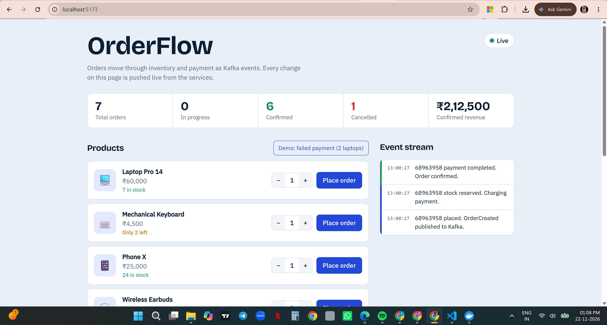
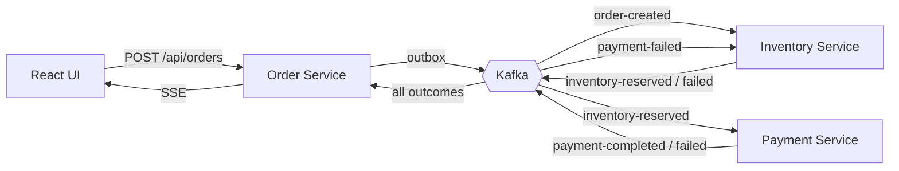

# OrderFlow

An event-driven order processing platform built with **Java 17, Spring Boot, Apache Kafka, PostgreSQL and React**.
Orders flow through inventory and payment services asynchronously over Kafka, and the UI updates live as each step completes.

## Architecture



| Service | Port | Database | Role |
|---|---|---|---|
| order-service | 8081 | orderdb | Creates orders, tracks status, streams live updates (SSE) |
| inventory-service | 8082 | inventorydb | Product catalog, reserves and releases stock |
| payment-service | 8083 | paymentdb | Mock payment (declines amounts over ₹1,00,000) |
| frontend | 5173 | none | React UI |

Each service owns its own database. Services only talk through Kafka events.

## Run it

Requirements: Docker, Node 18+.

```bash
docker compose up --build      # Kafka (KRaft), Postgres and the 3 services
cd frontend && npm install && npm run dev
```

Open http://localhost:5173.

Try it:
- Order 1 earbuds: PENDING, STOCK_RESERVED, CONFIRMED.
- Order 2 laptops (₹1,20,000): payment is declined, the order is CANCELLED and the laptop stock goes back up. This is the saga rollback.
- Order 5 keyboards (only 3 in stock): cancelled by inventory straight away.

## Patterns implemented

- **Saga (choreography)**: no central coordinator. A failed payment emits `payment-failed`, and inventory compensates by releasing the stock.
- **Transactional outbox**: the order and its `order-created` event are written in one DB transaction; a publisher relays them to Kafka. If Kafka is down, nothing is lost.
- **Idempotent consumers**: inventory records processed events, and payments are keyed by order id, so redelivered messages are harmless.
- **Retries and dead letter topics**: failing messages are retried 3 times, then published to `<topic>.DLT`.
- **Real-time UI**: Kafka event, then Server-Sent Events, then React. No polling.
- **Health and metrics** via Spring Actuator (`/actuator/health`, `/actuator/metrics`).
- **CI**: GitHub Actions builds and tests every service and the frontend.

## Design decisions

- **Why Kafka and not REST between services?** Order placement stays fast and available even if payment is slow or down, and events can be replayed.
- **Why choreography over orchestration?** Three steps is simple enough that a coordinator adds more moving parts than it removes. With many more steps I would switch to an orchestrator.
- **Why SSE and not WebSocket?** Updates only flow server to browser, and SSE gives automatic reconnects with less code.
- **Delivery semantics**: at-least-once delivery plus idempotent handlers, which gives effectively-once results without Kafka transactions.
- **Known simplification**: the client sends the price in the order request. A production system would have the order service look it up.

## Ideas to extend

API gateway with JWT auth, Testcontainers integration tests, Prometheus and Grafana, a notification service, k6 load tests, Kubernetes manifests.

## Run tests

```bash
cd order-service && mvn test
```
